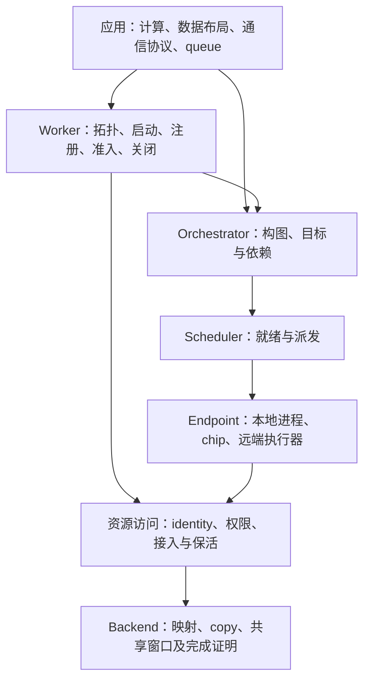

# L3+：设计原则、职责与代码地图

> **发布快照：2026-10-21。** 设计、实现状态与历史调查须按正文各自基线阅读；不代表当前 main 全量验收。参见[阅读入口与已知更正](README.md)。
>
> 源码基线：main `fdcbdcc9502195f7837030cf3c130f75f83d3719`，2026-10-21（America/Los_Angeles）。本文按该 SHA 的实现梳理设计；“目标约束”不冒充全部落地。源码与现有测试已阅读，本次不构建、不重跑硬件或 CI。实施状态仍只在 [work-items.md](work-items.md)，全目标核验日期仍为 2026-10-18。

**L3+ 的职责，是把用户声明的任务、资源访问和依赖，落实为有明确归属、可验证顺序与可安全回收的执行。** 应用定义计算与通信协议；simpler 管理执行和资源机制。L3、L4 是编排树的位置，不能单凭层级推出内存可达性或通信能力。

## 1. 一张图与六个概念



这是职责图，不是现有文件的分层图。`worker.py` 同时含多种职责，模块拆分不能照抄现有文件边界。

 | 概念 | 回答的问题 | 必须分开的概念 |
 | ---- | ---------- | -------------- |
 | Worker / endpoint | 谁接受任务，处在哪个部署与控制树中？ | level、worker id、设备 id、MPI rank、domain rank 各有自己的命名空间 |
 | CallableHandle | 注册了哪个可执行内容，哪些目标能够执行？ | handle 属于注册它的 Worker；内容 digest 不授予跨 Worker 使用权 |
 | Run / Task | 哪次构图和执行；其中哪项工作依赖哪项？ | Python callback 返回、提交被接纳、设备完成、资源退休 |
 | Buffer / Tensor | 哪块 backing；这次访问其中哪些字节、shape/stride？ | identity、物化地址、allocation owner、访问者 |
 | Attachment / access path | 此 endpoint 如何合法访问此资源？ | source 登记不等于目标端授权或已经映射 |
 | CommDomain | 哪组成员按什么顺序使用哪些通信资源？ | 逻辑成员、device rank、资源 owner、控制 transport、kernel 数据路径 |

三种关系必须分别描述：**编排树**表达控制与部署归属；**任务 DAG**表达执行依赖；**资源访问关系**表达 endpoint 对 backing 的权限与路径。它们相互关联，但不能用其中一张图推导另外两张。

## 2. 我们的设计原则

### 逻辑身份与物理部署分开

Worker path 用于定位与控制路由，Buffer identity 用于标识资源；VA 是某个执行上下文里的访问结果。改变进程、路由或映射不能偷偷改变资源语义。潜在可达性由 deployment、互连、backing/backend 与 runtime support 决定；实际使用还要求授权、live attachment 与有效生命周期。

这是 [逻辑/物理总纲](logical-physical-separation.md) 的规则。当前 Python 仍有 `level == 2/3` 分派，当前建域仍区分 chip id 与 `(node, chip)`；这些是实现限制，不能推广成设计上永远绑定层级的理由。

### 公开接口小，机制在内部收敛

用户需要表达目标、资源和依赖，不应逐跳操纵 mailbox、native slot、session frame 或 cleanup journal。内部可以有不同 adapter 和类型化 registry，但同一种操作应遵守同一份身份、失败与完成契约。

统一接口必须保留差异：支持的访问、ownership、同步/异步完成、失败条件应明确。不能用一个同名函数掩盖“映射原 Buffer”与“另分配 Buffer 再复制”的区别，也不能以“统一”为由把所有状态塞进一张表。

### 运行时提供共享区间与访问保证，应用提供协议

simpler 负责资源身份、范围、授权、映射/copy、必要的可见性与顺序保证、后端支持的原子操作、完成与安全回收。应用决定字段布局、信号的含义、何时通知/等待、queue 算法、opcode、batching、背压和业务 STOP。

`写 payload → 发布 ready / 观察 ready → 读 payload`：应用选择协议，底层必须让这两条顺序关系可表达且可靠。不能把地址可写当成自动 coherence；也不要求应用各自复制硬件 cache 维护代码。只提升已经证明通用、可以独立验收的最小原语。

SPSC 是受 CI 看护的参考样例。验收问题是：**应用在 simpler 仓库之外，只用公开资源/访问接口，能否实现另一种 queue？** runtime 自己的调度队列、取消和 drain 仍由 runtime 负责；它们不要求应用采用某种消息格式。此边界对应 [#2635 设计评论](https://github.com/hw-native-sys/simpler/pull/2635#issuecomment-6284970983)，是 RA-11 的目标约束，不是宣称 main 已完成接口迁移。

### 一个资源有明确 owner，每个使用有自己的保留

allocation owner 负责最终释放；mapping/import grant、run、DMA、graph 或 collector 各自持有使用权。owner 与使用者不能合并成“谁最后调用 free”。外部借用不转移 allocation ownership，保留一个描述符不能替调用方延长外部 allocation 的实际寿命。

逻辑关闭停止新使用；物理回收等待最后使用者与后端释放证明。失败且静止未知时保留资源和清理责任，不因抛异常、超时或删字典而视为完成。具体合同见 [访问、完成与资源退休](worker-memory-model/access-retirement-contract.md)；Buffer/domain registry 的组织仍由契约 D 裁决。

### 构图、控制与执行各有顺序，不能相互代替

任务从 ready queue 派发，直接控制命令从 mailbox/control 通路发出。任务 FIFO 不自动排序控制命令。当前实现要求 L3 callback 中直接设备控制发生在第一次 task submit 前；域/region 清理若会触碰设备，还必须进入后继准入的顺序约束。

同步接口应是同一执行协议的组合：当前 `run = submit + wait`。增加异步入口不能创建另一份资源账本或错误语义。同步构图也不代表等整张图构好后设备才开始工作。

### 并发由资源与完成证明授权

分别记录 accepted 请求容量、transport frame、native prepared 资源、launch/enqueue 容量和执行顺序。某个目录能命名 N 个 slot，不表示已经分配 N 份 device workspace；提交 N 个请求不表示 N 个 kernel 同时执行。

pipeline slot 复用必须校验 generation；run 的错误、输出和诊断在 slot 交还前要转交正确 owner。优化只能放宽已有证明覆盖的路径，不能把 local chip 的能力外推到 nested/remote/MPI。

### 取得资源、发布能力、退休责任是完整事务

在调用方可见发布之前完成验证、取得资源和登记回滚责任；跨节点准备不完整时不能发布可用域。已发出的 DMA、kernel 或远端命令不能用本地 rollback 假装未发生。

正常路径和失败路径共用 ownership 模型。失败清理保留原始错误与残留资源；可重试的是尚未证明成功的清理动作，不是任意重复有副作用的操作。`CLOSED` 是准入终态，清理是否完成是另一维。

### 能力与验收按路径声明

区分“代码有实现”“测试有覆盖入口”“某 SHA 的某平台实测通过”。每个支持路径要有成功复用与非法/失败拒绝两侧证据。CPU fake 证明协议，硬件可见性需要硬件证据；控制通路的名称不证明或否定设备数据面。

## 3. 当前代码怎样兑现这些原则

### 启动与注册

`Worker.init()` 取得启动 epoch，递归初始化本地子树、激活远端并等待 READY，最后在生命周期锁内发布 READY；失败走有 deadline 的回滚。`run` 不承担隐式启动。`_operation_lease()` 在整个操作期间阻止树被 teardown；`close()` 永久关闭准入，再 drain 与清理。

注册由 `CallableHandle`、digest、kind、target namespace 和 eligible workers 共同约束；注册内容身份与 Worker-local handle 权限分开。[启动/lease/close 源码](https://github.com/hw-native-sys/simpler/blob/fdcbdcc9502195f7837030cf3c130f75f83d3719/python/simpler/worker.py#L7598) · [启动提交点](https://github.com/hw-native-sys/simpler/blob/fdcbdcc9502195f7837030cf3c130f75f83d3719/python/simpler/worker.py#L8875) · [handle 生成](https://github.com/hw-native-sys/simpler/blob/fdcbdcc9502195f7837030cf3c130f75f83d3719/python/simpler/worker.py#L7477)。

### 一次 L3+ run

```text
submit
  → 取得 Worker operation lease 与构图串行权
  → 必要时等待前一 run 的设备清理交接
  → native begin_run：进入有界 FIFO，建立 run identity
  → callback(Orchestrator)：直接控制在前，随后提交任务与依赖
  → Scheduler 派发 ready task；FIFO 头可在 callback 返回前执行
  → 关闭本 run 的提交入口，返回 RunHandle
  → endpoint completion / run fence
  → run-owned 资源清理、错误发布、native run 退休
```

这不是严格无重叠的时间线。当前 `begin_run()` 先进入 pending FIFO，native slot lease 在具备角色时才授予；不能沿用“begin_run 总会立即取得 native slot”的旧描述。`submit()` 的 callback 在调用线程内同步构建；返回的 handle 管后续完成。

`Orchestrator` 验证精确 NEXT_LEVEL 目标、参数来源和显式依赖；native `infer_deps` 用本地 canonical identity 与 view footprint 查重叠 producer，并区分 INPUT/INOUT/OUTPUT 的含义。remote sidecar 走自己的 owner/buffer/generation/offset 键。这里不是对任意内存访问自动发现 race：声明的 tag、显式依赖和支持的 view 仍是调用方合同。

`Scheduler` 处理依赖就绪、group reservation、定向队列、prepare 和有限 early launch；`WorkerManager` / endpoint lane 承担具体投递与 completion。自动准入当前限于拥有 startup 的本地 L3 和四个 onboard program backend；nested、remote、MPI、sim 不据此获得相同能力。

[Python submit 与限制](https://github.com/hw-native-sys/simpler/blob/fdcbdcc9502195f7837030cf3c130f75f83d3719/python/simpler/worker.py#L12974) · [direct control 顺序](https://github.com/hw-native-sys/simpler/blob/fdcbdcc9502195f7837030cf3c130f75f83d3719/python/simpler/orchestrator.py#L241) · [native begin_run](https://github.com/hw-native-sys/simpler/blob/fdcbdcc9502195f7837030cf3c130f75f83d3719/src/common/hierarchical/orchestrator.cpp#L69) · [依赖推导](https://github.com/hw-native-sys/simpler/blob/fdcbdcc9502195f7837030cf3c130f75f83d3719/src/common/hierarchical/orchestrator.cpp#L1523) · [调度循环](https://github.com/hw-native-sys/simpler/blob/fdcbdcc9502195f7837030cf3c130f75f83d3719/src/common/hierarchical/scheduler.cpp#L481)。

### 资源、建域与通信

`Buffer` 是 backing 的描述与管理入口，`Tensor` 是带几何信息的视图。`Buffer.wrap` 是外部设备内存的源登记，不是分配或跨目标自动授权。`EndpointRegistry → BackendResolver → materialize` 分别解决定位、访问计划和实际取得资源；计划成功不代替最终 mapping/lease 成功。

main 的 `allocate_domain(members=...)` 已统一 L3/L4 公共入口；`get_or_allocate_domain` 用不可变 `DomainConfig` 比较成员顺序、buffer 定义、window、retention 与 topology，同配置命中返回原 handle，不重置内容。`allocate_global_domain` 是兼容入口。内部 local/global allocation、live table、释放路径仍分开；API 统一不能关闭 RA-12/RA-15 的生命周期目标。

跨节点路径在控制层验证成员与 capability，执行 PREPARE_EXPORT、IMPORT、COMMIT，并在失败时清理/ABORT。启动采用 mpirun；main 同时有既有 MPI group/mailbox、direct MPI supervisor/controller/executor 以及 TCP session 路径。它们解决进程/会话/控制投递；共享窗口的实际访问另由 backend 与设备程序实现。direct MPI 已存在，不代表 group 路径已经退役或生产 cleanup 全部完成。

[Buffer.wrap](https://github.com/hw-native-sys/simpler/blob/fdcbdcc9502195f7837030cf3c130f75f83d3719/python/simpler/buffer.py#L348) · [访问计划](https://github.com/hw-native-sys/simpler/blob/fdcbdcc9502195f7837030cf3c130f75f83d3719/python/simpler/comm_endpoints.py#L826) · [统一建域与复用](https://github.com/hw-native-sys/simpler/blob/fdcbdcc9502195f7837030cf3c130f75f83d3719/python/simpler/worker.py#L10337) · [跨节点建域](https://github.com/hw-native-sys/simpler/blob/fdcbdcc9502195f7837030cf3c130f75f83d3719/python/simpler/worker.py#L11345) · [direct MPI controller](https://github.com/hw-native-sys/simpler/blob/fdcbdcc9502195f7837030cf3c130f75f83d3719/python/simpler/mpi_direct_runtime.py#L231)。

### 完成与清理

`_RunResources` 聚合本 run 的域、region、远端引用和清理责任；`_RunFinalizationCursor` 记录 one-shot 清理边界；`CleanupJournal` 只在清理成功后移除条目。业务执行失败和资源清理失败分别处理，后者可能禁止该 Worker 再准入。

需要保留三个不同事实：源不再被读、目的可供消费者使用、操作已静止。本文将它们作为共同设计合同；现有所有 backend 尚不能据此一概宣称已经具备独立且完整的证明接口。

[run resources](https://github.com/hw-native-sys/simpler/blob/fdcbdcc9502195f7837030cf3c130f75f83d3719/python/simpler/worker.py#L4860) · [finalizer](https://github.com/hw-native-sys/simpler/blob/fdcbdcc9502195f7837030cf3c130f75f83d3719/python/simpler/worker.py#L13615) · [cleanup journal](https://github.com/hw-native-sys/simpler/blob/fdcbdcc9502195f7837030cf3c130f75f83d3719/python/simpler/worker.py#L4717) · [close](https://github.com/hw-native-sys/simpler/blob/fdcbdcc9502195f7837030cf3c130f75f83d3719/python/simpler/worker.py#L13880)。

## 4. 复杂度在哪里，模块应如何承担责任

本基线 `worker.py` 14,566 行，`orchestrator.py` 910 行；这些数字只是阅读导航，不是设计优劣评分。主要复杂度是同一入口协调多种状态机和 ownership 交接，单纯挪文件不会减少必须理解的合同。

 | 责任模块 | 应拥有的状态和保证 | 当前代码位置 | 不能越界承担 |
 | -------- | ------------------ | ------------ | ------------ |
 | Worker lifecycle | 启动 epoch、READY/CLOSED、operation lease、树 teardown | `worker.py` lifecycle、init/close、CleanupJournal | queue 消息协议、设备算法 |
 | Callable registration | 内容身份、handle 权限、目标资格、注册回滚 | `callable_identity.py`、`worker.py` register/unregister | run 资源容量、allocation owner |
 | Run execution | 准入、DAG、依赖、派发、结果与完成交接 | `orchestrator.py`、native hierarchical Orchestrator/Scheduler/WorkerManager、chip run lane | 假定任意 buffer 可访问；把 transport ACK 当设备完成 |
 | Resource access | backing identity、授权、attach/copy、使用保留与退休 | `buffer.py`、comm endpoints/provider/region、Worker 内资源表 | 应用字段、queue layout、业务 STOP |
 | Distributed session | topology、会话身份、启动/health、frame/control 投递与退出证据 | mpi direct/group、remote session/protocol、Worker 连接代码 | 决定共享窗口天然 coherent；替资源 owner 宣告 free |
 | Domain assembly | 成员顺序、资源组合、配置复用、prepare/commit/abort | `comm_domain.py`、`global_comm_domain.py`、Worker domain 路径 | 重新定义 Buffer 生命周期或借名称建立另一套资源所有权 |

这是推荐的职责组织，不是六个新公共类或六条新实施线。模块深度来自“小接口隐藏完整机制”：移除一个模块时，如果必要的硬件/并发复杂度会散回所有应用，它值得存在；如果只是透传并暴露内部表，应该收窄接口。优先建立真实入口上的合同测试，再按 owner 分离实现，不做一次性大搬家。

几处必须保留的现状/目标差异：

- **共享区间与 queue**：main 仍有 `create_worker_chip_region/queue` 与专用模板；目标是资源/访问接口加上层样例。#2635 的公共入口不能因“更通用的名字”自动获得合理的职责范围。
- **统一生命周期**：`Buffer.close()` 的 host shm 路径仍直接 close/unlink；domain 仍有 local/global 表。共同退休规则是目标，不能写成“统一 registry 已完成”。
- **并发控制**：构图串行、直接控制前置、带设备清理的 run 交接，都是有原因的当前限制。放宽前需补顺序与故障证明。
- **会话收敛**：direct MPI 与 group/TCP 并存。统一 Supervisor、session epoch 与 cleanup 是独立交接，不能从 direct transport 合入推导全部结束。

## 5. 评审与验收怎么使用本文

评审每个新增接口或模块，先回答：它隐藏了哪类必要复杂度？哪个 owner 负责状态？在哪个时刻发布、接纳和退休？支持哪些 endpoint/backend？失败后谁仍可能访问资源？能否用已有机制实现，而不再建一套 registry、协议或可配置状态？

 | 合同 | 已读测试入口（源码存在，不是本轮 PASS 声明） | 必须保留的对照 |
 | ---- | -------------------------------------------- | -------------- |
 | init 的整树 READY 与回滚 | `tests/ut/py/test_worker/test_startup_readiness.py` | 多 child 正常 READY；一个 child 失败后兄弟回收 |
 | 生命周期与控制准入 | `test_worker/test_admission_fence.py`、`test_cancellation_journal.py` | 正常 lease 结束后关闭；close/submit 或取消竞争时保留责任 |
 | capacity 与 slot 复用 | `test_worker/test_pending_run_depth.py`、`test_automatic_admission_scope.py`；native `test_chip_run_lane*.cpp` | 正常多轮复用；容量之外拒绝、旧 generation 不影响新 run |
 | domain 配置与内容复用 | `tests/ut/py/test_comm_domain.py` | 同配置保留原内容与 identity；配置差异无设备副作用；后续 run 释放 |
 | endpoint 能力 | `test_worker/test_comm_endpoints.py` | 支持路径有执行者；非法 owner/epoch、HOST × VMM 直映拒绝 |
 | MPI transport | `tests/ut/py/test_mpi_direct.py`；native `test_mpi_direct_transport.cpp` | 有效 session 路由；错误 frame/session 与关闭路径 |

路径缩写 `test_worker/` 位于 `tests/ut/py/`，native 测试位于 `tests/ut/cpp/common/hierarchical/`。测试数量或守卫全绿不能代替这些合同的语义审查。

实施仍按三线分工：RA 管资源与访问、DS 管会话与通信域、EX 管执行与常驻运行。本文不新增编号、里程碑或第二份状态表；相关入口见 [分线契约](track-boundaries.md)、[用户面](worker-memory-model/user-surface.md)、[总路线图 §2.6](feature_roadmap.md#26-runtime-基础能力参考-adapter-与用户自定义的边界)。
