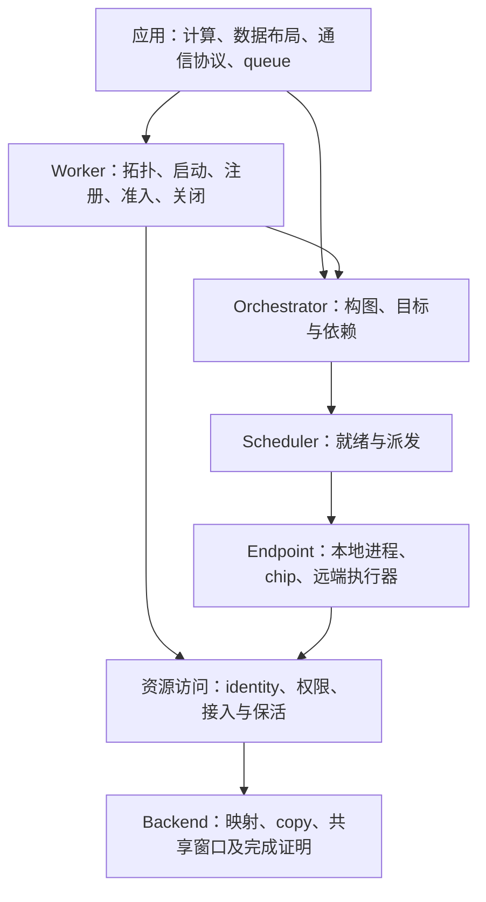

# L3+：设计原则、职责与代码地图

> **发布快照：2026-11-10。** GitHub 进展与依赖投影；源码和硬件结论按各自精确版本阅读。参见[阅读入口](README.md)。

> **设计依据**：#2716 原生四方向、正文与决定性评论；Host DDR 合同按 2026-11-10 观察的按调用 MAP / 共享整表 / 独立分片域解释，详见 [用户面 §5.2](worker-memory-model/user-surface.md#52-api-契约与已交付边界)。源码事实固定 main `63ffeb8a8bd9b6527912fee87f6a8defdf82d5e0`；下文明确区分实现与目标。实际进度查 GitHub；本地归属与验收入口见 [工作项](work-items.md)，来源和验收证据见 [范围分析](review/track-2716.md)。本轮没有执行产品或硬件测试。

**L3+ 的职责，是把用户声明的任务、资源访问和依赖，落实为有明确归属、可验证顺序与可安全回收的执行。** 应用定义计算与通信协议；simpler 管理执行和资源机制。L3、L4 是编排树的位置，不能单凭层级推出内存可达性或通信能力。

## 1. 一张图与六个概念



这是职责图，不是现有文件的分层图。`worker.py` 同时含多种职责，模块拆分不能照抄现有文件边界。

| 概念 | 回答的问题 | 必须分开的概念 |
| --- | --- | --- |
| Worker / endpoint | 谁接受任务，处在哪个部署与控制树中？ | level、worker id、设备 id、MPI rank、domain rank 各有自己的命名空间 |
| CallableHandle | 注册了哪个可执行内容，哪些目标能够执行？ | handle 属于注册它的 Worker；内容 digest 不授予跨 Worker 使用权 |
| Run / Task | 哪次构图和执行；其中哪项工作依赖哪项？ | Python callback 返回、提交被接纳、设备完成、资源退休 |
| Buffer / Tensor | 哪块 backing；这次访问其中哪些字节、shape/stride？ | identity、物化地址、allocation owner、访问者 |
| Attachment / access path | 此 endpoint 如何合法访问此资源？ | source 登记不等于目标端授权或已经映射 |
| CommDomain | 哪组成员按什么顺序使用哪些通信资源？ | 逻辑成员、device rank、资源 owner、控制 transport、kernel 数据路径 |

三种关系必须分别描述：**编排树**表达控制与部署归属；**任务 DAG**表达执行依赖；**资源访问关系**表达 endpoint 对 backing 的权限与路径。它们相互关联，但不能用其中一张图推导另外两张。

## 2. 我们的设计原则

### 逻辑身份与物理部署分开

Worker path 用于定位与控制路由，Buffer identity 用于标识资源；VA 是某个执行上下文里的访问结果。改变进程、路由或映射不能偷偷改变资源语义。潜在可达性由 deployment、互连、backing/backend 与 runtime support 决定；实际使用还要求授权、live attachment 与有效生命周期。

这是 [逻辑/物理总纲](logical-physical-separation.md) 的规则。当前 Python 仍有 `level == 2/3` 分派，当前建域仍区分 chip id 与 `(node, chip)`；这些是实现限制，不能推广成设计上永远绑定层级的理由。

### 公开接口小，机制在内部收敛

用户需要表达目标、资源和依赖，不应逐跳操纵 mailbox、native slot、session frame 或 cleanup journal。内部可以有不同 adapter 和类型化 registry，但同一种操作应遵守同一份身份、失败与完成契约。

统一接口必须保留差异：支持的访问、ownership、同步/异步完成、失败条件应明确。不能用一个同名函数掩盖“映射原 Buffer”与“另分配 Buffer 再复制”的区别，也不能以“统一”为由把所有状态塞进一张表。

### 运行时提供共享区间与访问保证，应用提供协议

simpler 负责资源身份、范围、授权、映射/copy、必要的可见性与顺序保证、后端支持的原子操作、完成与安全回收。应用决定字段布局、信号的含义、何时通知/等待、queue 算法、opcode、batching、背压和业务 STOP。

`写 payload → 发布 ready / 观察 ready → 读 payload`：应用选择协议，底层必须让这两条顺序关系可表达且可靠。不能把地址可写当成自动 coherence；也不要求应用各自复制硬件 cache 维护代码。只提升已经证明通用、可以独立验收的最小原语。

目标中的 SPSC 是受 CI 看护的参考样例。验收问题是：**应用在 simpler 仓库之外，只用公开资源/访问接口，能否实现另一种 queue？** runtime 自己的调度队列、取消和 drain 仍由 runtime 负责；它们不要求应用采用某种消息格式。此边界对应 [#2635 设计评论](https://github.com/hw-native-sys/simpler/pull/2635#issuecomment-6284970983)，是 #2720 的目标约束，不是宣称 main 已完成接口迁移。

### 一个资源有明确 owner，每个使用有自己的保留

allocation owner 负责最终释放；mapping/import grant、run、DMA、graph 或 collector 各自持有使用权。owner 与使用者不能合并成“谁最后调用 free”。外部借用不转移 allocation ownership，保留一个描述符不能替调用方延长外部 allocation 的实际寿命。

逻辑关闭停止新使用；物理回收等待最后使用者与后端释放证明。失败且静止未知时保留资源和清理责任，不因抛异常、超时或删字典而视为完成。具体合同见 [访问、完成与资源退休](worker-memory-model/access-retirement-contract.md)；Buffer/domain registry 的组织仍由契约 D 裁决。

### 构图、控制与执行各有顺序，不能相互代替

任务从 ready queue 派发，直接控制命令从 mailbox/control 通路发出。任务 FIFO 不自动排序控制命令。当前实现要求 L3 callback 中直接设备控制发生在第一次 task submit 前；域/region 清理若会触碰设备，还必须进入后继准入的顺序约束。

同步接口应是同一执行协议的组合：当前 `run = submit + wait`。增加异步入口不能创建另一份资源账本或错误语义。同步构图也不代表等整张图构好后设备才开始工作。

### 并发由资源与完成证明授权

分别记录 accepted 请求容量、transport frame、native prepared 资源、launch/enqueue 容量和执行顺序。某个目录能命名 N 个 slot，不表示已经分配 N 份 device workspace；提交 N 个请求不表示 N 个 kernel 同时执行。

pipeline slot 复用必须校验 generation；run 的错误、输出和诊断在 slot 交还前要转交正确 owner。优化只能放宽已有证明覆盖的路径，不能把 local chip 的能力外推到 nested/remote/MPI。

### 取得资源、发布能力、退休责任是完整事务

在调用方可见发布之前完成验证、取得资源和登记回滚责任；跨节点准备不完整时不能发布可用域。已发出的 DMA、kernel 或远端命令不能用本地 rollback 假装未发生。

正常路径和失败路径共用 ownership 模型。失败清理保留原始错误与残留资源；可重试的是尚未证明成功的清理动作，不是任意重复有副作用的操作。`CLOSED` 是准入终态，清理是否完成是另一维。

### 能力与验收按路径声明

区分“代码有实现”“测试有覆盖入口”“某 SHA 的某平台实测通过”。每个支持路径要有成功复用与非法/失败拒绝两侧证据。CPU fake 证明协议，硬件可见性需要硬件证据；控制通路的名称不证明或否定设备数据面。

## 3. 资源与执行：当前实现及共同合同

### 域从创建起有 owner，run 登记自己的使用

当前 main 的 `allocate_domain(members=...)` / `get_or_allocate_domain` 共用入口，`DomainConfig` 比较有序成员、buffer 定义、window、retention、topology 与 `workspace_engines`。同配置复用返回原 handle，不重置数据。创建/复用发生于所属 Worker 的 orchestration callback；创建时选择 `retain_after_run`。

Worker 的 local/global live table 持有域；`_RunResources` 记录本 run 的使用与清理义务。`_enroll_domain_uses` 从实际 touched Buffer identity 登记缓存 Tensor 的后续 run 使用；显式 get_domain / checked context 路径登记上下文使用。**跨 run 保留不再需要把域从 run detach 给另一个 owner。** 配置复用、逻辑关闭、在飞 fence 和 backend 物理释放仍是不同合同。#824 的原始行为应对照现有实现核定，而不是据旧 API 名重新开发。

来源：[Worker 域入口与使用登记](https://github.com/hw-native-sys/simpler/blob/63ffeb8a8bd9b6527912fee87f6a8defdf82d5e0/python/simpler/worker.py)、[不可变 DomainConfig](https://github.com/hw-native-sys/simpler/blob/63ffeb8a8bd9b6527912fee87f6a8defdf82d5e0/python/simpler/comm_domain.py)、[域公共合同](https://github.com/hw-native-sys/simpler/blob/63ffeb8a8bd9b6527912fee87f6a8defdf82d5e0/docs/comm-domain.md)。这些公共机制不证明 URMA/RDMA 所有异常释放都已闭合，后者按 #2787/#2823 验收。

### Buffer identity、访问选择与调用策略分开

Buffer 表达 backing 身份、位置、容量和 owner；Tensor 表达几何。#2730/#2731 通过 TaskArgs 条目级 `TensorTransfer.MAP` 选择目标端访问；Tensor 保持同一 backing identity，目标 registry 独立解析并保留实际 mapping。direction 与 transfer 均属于每次调用，Buffer 不回写目标地址。

native CPU import、Device mapping、URMA registration 各有自己的目标上下文和生命周期。映射不复制；显式 H2D 产生独立 Device 存储。保持公共 Buffer/Tensor/TaskArgs 与既有 adapter 路径，不因 Host table 再建参数系统。具体约束见 [用户面 §5.2](worker-memory-model/user-surface.md#52-api-契约与已交付边界)。

### 完成不是一个布尔值

```text
接纳请求并保留资源 → 准备 / 发布 → 设备执行与传输
  → 物理最后使用证明 → 归还对应执行容量
  → 结果观察 / 输出交付 / 错误发布 → 退休相应结果与使用记录
```

这些阶段允许重叠；不同资源的最后使用点不同。当前 completion fence 将物理完成与强结果观察分开；完成执行后仍可能保留 caller-held 结果。`pipeline_depth` 限执行容量，不封顶未观察结果内存；backlog 计数也不是容量限制。见 [完成合同](https://github.com/hw-native-sys/simpler/blob/63ffeb8a8bd9b6527912fee87f6a8defdf82d5e0/docs/design/run-completion-fence.md)。

对传输还要分别证明源不再被读、目的对消费者可见、所有已发布工作已静止。issue kernel 返回、控制 ACK、超时与 transport send 返回都不能替代这些证明。DMA/网络请求、输出消费者、graph、结果 carrier 各自保留实际使用；未知完成时不提前回收。

### 资源清理从第一笔分配开始负责

资源取得、失败回滚责任登记、能力发布构成完整事务。URMA 中 communicator 级可共享资源与 domain 注册、peer 映射和描述符按真实依赖区分；当前 SDMA manager 在 communicator、URMA manager 在 domain 的差异不要求通过“搬到同一个位置”消除。

正常 domain release 必须停止新接纳、确认执行/网络静止、解除注册/channel 引用，再释放 backing。释放 A 后存活 B 必须可继续使用；把所有资源拖到 Worker 退出不满足独立域回收。失败后保留有依据的剩余 owner、句柄和错误；已成功释放的独立资源可以清账。不能把析构/reset、返回 false 或空 workspace 当作无残留证明。见 [退休契约](worker-memory-model/access-retirement-contract.md)。

## 4. 四方向如何承载完整设计

| 完整业务方向 | 交付边界 | 本地合同索引 |
| --- | --- | --- |
| #2721 编排调度、下发与资源访问 | #2460 的身份/视图/访问/寿命；#1931 free provenance；#2720 Region 完整方案 | GitHub 公共资源入口与 EX |
| #2722 通信与后端 | 域复用、后端 workspace、Host fetch、必要通信 kernel、完成与安全释放随场景交付 | DS；公共访问/退休与 EX 完成联验 |
| #2723 单 L2 Run 常驻 | 多轮 work/completion、停止接纳与 drain；分别证明 L3 进程复用、重复 run、单 Run 多轮 | #2723 |
| #2724 多级多机部署 | mpirun 启动、会话/拓扑、Supervisor 与 Group 迁移、跨节点退出证据 | #2724/#2722 |

GitHub 目标与验收入口 是横切合同索引，不重复分配场景 owner。方向编号不规定执行顺序。公共基础只有独立价值和验收时才另列；#2621/#2657 所需资源和执行改动留在完整场景。

### Device 通信能力按路径选择

main 的 A5 SDMA/URMA provider 默认编译；域默认 `workspace_engines=()`，按需申请异步 workspace。A2/A3 的 `enable_sdma` 与 Worker 资源语义保持独立。当前 A5 URMA host 入口限定 L3、TMR、dense-prefix 有序成员；RDMA 仍有独立构建和使用限制。编译存在、资源创建成功、实际传输通过各自计证。来源：[A5 构建](https://github.com/hw-native-sys/simpler/blob/63ffeb8a8bd9b6527912fee87f6a8defdf82d5e0/src/a5/platform/onboard/host/CMakeLists.txt)、[资源构建与销毁](https://github.com/hw-native-sys/simpler/blob/63ffeb8a8bd9b6527912fee87f6a8defdf82d5e0/src/a5/platform/onboard/host/comm_hccl.cpp)、[Worker 校验](https://github.com/hw-native-sys/simpler/blob/63ffeb8a8bd9b6527912fee87f6a8defdf82d5e0/python/simpler/worker.py)。

| 目标 | 不可混为一项的验收 |
| --- | --- |
| #2738 上下文入口 | A2/A3 SDMA 入口统一保留启用语义、资源 owner 和无 HCCL 域的单卡路径；不是其他 workspace 交付的硬前置 |
| #2673 多 AIV / 多 peer | 稳定执行者到独占队列的映射；共享池另归 #2910，当前暂缓，不作为已交付能力 |
| #2833 重叠域 | AB/BC 同时存活、域内 rank/peer 映射正确、独立释放/重建；同时存活不等于传输时间重叠 |
| #2855 批量 TPUT | 首版单域、单发送者、同 peer；明确暂存、flush、尾批和实际多队列完成；可独立于多 AIV 交付 |
| #2787 / #2823 生命周期 | URMA 与 RDMA 各自证明实际 manager、注册/channel 依赖、部分初始化和释放失败闭环 |
| #2824 / #2854 / #2860 | RDMA 实机资格、分块 PUT 故障、分块 GET 故障分别验收；一次正常通过不消除间歇故障 |

以上为设计与验收分工，状态见工作项。#2673 的旧“每 peer 必共用 SQ”与 #2674 的 query/enable 备选已由决定评论取代；不能照旧正文复活为新工作。

### Host DDR：本地 MAP 与独立分片域

#2730 负责 direct L2 Host Buffer 的按调用 MAP 与同步本地 MTE；native/NONE/H2D 保留。#2731 复用该合同，由 L3 拥有完整 Host backing，在外层调用的 callback/设备执行前准备所有必需 child；至少两张 A5 的真实多进程证据用于验收，不是 MAP 的 peer 建链前置。支持多个 backing，各 child 本地 MTE，不准备 URMA。分片 Host 域及首次初始化另归 #2922/#2938。**应用负责布局和分片，MAP 不自动复制整表。**

```text
共享整表：L3 拥有 backing → 调用 MAP 准备所有必需 child
  → callback 下发本地 MTE → 最后使用完成 → 协调各 child 清理
分片域：各 L2 拥有独立 Host window → domain 建立映射/URMA
  → 首次创建 initializer → 本地 MTE / 远端异步 URMA → domain 寿命回收
```

本地 MAP 不创建通信域、peer、MR 或 workspace。整表 backing 不按 rank 复制；多个 backing 的独立映射必须可共存。首次使用未声明 backing 的 callback 动态准备、子集/懒准备与 L4/跨节点 MAP 不属于 #2731 首版。L3 HBG 也须独立接入和验收。

分片域使用 domain 自己的通信资源，映射与 URMA 的可达性分别核定；#2922 的 PCIe ACK timeout 限制不能用本地 MTE 成功消除。应用决定分片、索引、何时读什么和如何重叠计算；runtime 不自动 gather。#2938 的首次初始化不包含 checkpoint 格式或 Serving 接入。父项 #2657 仍保留所选路径的异步完成、有效计算重叠与应用验收。

### Owner-local 扩展与部署

#2621 的扩展在已有 chip owner 的有效 device/context 中初始化，借用已校验的存储；停止后端访问并注销后才能解除 pin，且先于 allocation/context teardown。pin 保活不代替 producer-ready 或计算排序；扩展不取得物理 allocation ownership，也不要求引入通用 RPC 或第三方引擎依赖。

跨节点沿用 mpirun 与原生 CANN ACL Runtime/PTO 路线；SHMEM 是参考而非库依赖，具体后端按需使用 HCCL/Hcomm。启动控制通路与实际共享窗口数据面分别验收。#2659 的持久外部账本、关闭期限、故障回收与 Group 迁移，不能被已有 Direct MPI health timeout / heartbeat drain 代替。

## 5. 评审与验收使用方式

新增接口先回答：哪个 owner 拥有资源；何时接纳与发布；哪个完成事实允许哪个动作；部分失败后谁还可能访问；是否存在正常回收的阳性对照。评审必须给出 main/PR/ISA/运行产物的具名版本，不能用历史 CI 绿代替当前路径。

| 合同 | 反例 | 配对阳性对照 |
| --- | --- | --- |
| 显式映射 | native/mapped 同 identity 被错误合并；失效引用复活；unmap 失败后仍接纳 | native CPU/H2D 保留，多个 view 正确偏移；停止读者后正常 unmap/retry |
| 多 L2 本地 MAP | 必需 child 未准备就发布、不同 backing 覆盖活映射 | 各 child 同一整表、至少两张 A5 本地 MTE；multiple backing 共存 |
| 分片 Host 域 | 本地 MTE 成功被误认为远端 URMA 可达 | 真实非 self PTO 读取、Host/Device 域共存；按硬件拓扑留证 |
| 域退休 | A 释放破坏 B；manager mock 替身遮住实际注册残留 | 真实 manager + 有状态 backend mock；多轮 allocate/release 与 B 持续可用 |
| 批量传输 | 暂存当完成、尾批遗失、仅追踪最后 jetty、部分提交后重复发送 | 显式 flush 和正常返回处理尾批；实际每队列目标达成后消费 |
| 执行/结果 | 执行 credit 归还即释放 caller-held 输出；旧 generation 完成影响新 run | 连续 run 复用执行资源，同时旧结果可观察且内容正确 |

CPU/mock 验证协议，硬件证明实际数据路径和可见性，device trace 证明有用计算重叠；三者不能互相替代。Region 完整方案仍按 #2720 分析，#2635 只是候选；registry 形状仍按契约 D 裁决。共同生命周期合同可以先履行。

进一步细节见 [分线契约](track-boundaries.md)、[用户面](worker-memory-model/user-surface.md)、[退休契约](worker-memory-model/access-retirement-contract.md) 与 [通信设计](l3l4/cluster-comm.md)。
