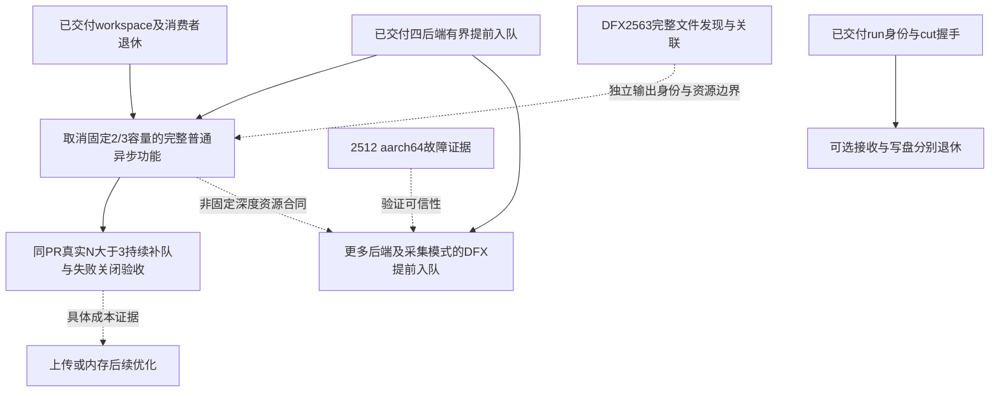

> **2026-10-21 接管快照**：保留原基线与历史结论；现状见[接管入口](../../../kernel-mode-cross-repo-handoff.md)，设计判断以[当前规范](../../../runtime-design-principles.md)为准。此页不授权恢复历史任务、timer 或自动化。

# Pipeline A 剩余工作与依赖（2026-10-13）

最新核对main a89c1170c（#2560已合入），派发门禁读取全部37个open PR。#2511/#2557已合入；#2558/#2562/#2564实际改动已核，仍由原作者负责。范围是用户的普通异步模型目标，不是把全仓open PR都转成我们的任务。候选不等于已批准实施；外部OPEN也不等于原作者仍在推进。

| 编号 | 剩余工作 | 状态/负责人 | 依赖 | 并行与授权 |
|---|---|---|---|---|
| A | 普通异步取消固定2/3槽的完整功能 | 原P4首稿已审、第二版修订中；整体未完成 | 独立run身份、mailbox/native/runtime资源寿命、按实际资源准入与最后消费者退休；四后端已有有界提前入队基础 | 与B并行设计；具体API/失败关闭/真实N>3验收方案待审，不再按容量数字拆PR |
| B | DFX完整发现与关联 | #2563原temporal修复当前审查及CI问题 | 完整身份、每run独占目录、工具配对、旧格式与失败/预算闭环 | 当前完整功能已批准，原作者同PR修复 |
| C | DFX Linux aarch64确定性失败 #2512 | OPEN、无评论；根因未确认，不能用x86/macOS绿灯代替 | 需要原平台/版本失败断言及实际源码核对；如需重新执行验证须遵守测试约束 | 证据分析可并行A/B；若改同collector测试文件，与temporal串行落地 |
| D | 更多普通提前入队路径可用DFX | 候选：A5 HBG/TMR泳道，之后逐collector评估；当前非全部支持 | 每个后端自身提前入队和设备池/计数/reset/cut寿命证明；四后端有限深度前置已具备；若支持非固定深度须与A的实际资源模型协调，B负责文件发现与关联 | 可并行设计；具体实施合同待形成，不是当前已批PR |
| E | 真实调用链完整验收与收益核实 | dynamic盘点已审结；通用DEVICE链和Partial多层测试已有。公开API晚读及路由覆盖须随所属完整功能补齐；真实Qwen双请求资格验证#2511已合入，生产更广覆盖仍需单独核验；性能收益仍未证明 | 四后端有限深度的既有验收已交付；A必须补齐非固定深度和持续排队验收。通用Worker语义与Qwen工作分开，#2511原作者不重复 | 盘点交付完成，原dynamic空闲；非固定深度验收归A同一PR，不另拆测试PR；未启动测试/benchmark |
| F | 异常停止、终态归属与定位 | 已有机制；仍需统一覆盖原始错误、Partial、子进程退出和内层task定位；#2536已合入，#2545仍由原作者负责 | A依赖自己的正确错误归属；全框架RTS/torch_npu接线不是A前置。必须核实际协议，不能仅以PR编号设依赖 | 与A并行审查/设计，共享runner代码需协调；用户已将torch_npu目标降为演进原则 |
| H | 采集结束与后台写盘资源分别退休 | 可选性能优化，报告已审结；不是#2534功能缺陷或当前必做项 | 依赖稳定run身份、cut/ACK、晚到记录归属与独立输出所有权；满host预算仍必须背压/拒绝，不能承诺慢盘永不阻塞 | 先取得实际瓶颈证据再决定；不派实现。现有2*sizeof(T)已覆盖记录合并副本，禁止重复加预算 |
| I | 更广拓扑和通信的提前入队 | 目前三run合同限本地L3单endpoint HBG；多endpoint/remote/MPI/通信不是全部支持 | 通信需跨rank最后消费者/失败排干证明；多endpoint需逐endpoint错误/容量/退休组合；与#1888/#1967/#2026/#2116/#2120等范围协调 | 前瞻设计；通信HOLD未解除，不是当前A/B前置 |
| J | ④prepare/上传后续成本 | 本阶段注册复用、TMR调用参数RTS载体、HBG图RTS载体、重复配置上传消除、调度存储复用已交付 | 如真实prepare/构图/可变状态初始化仍是瓶颈，由E证据或具体功能需求驱动；跨调用图缓存已撤回，不能自动重开 | dynamic审计已完成；没有证明新增上传/分配优化的必要性，当前无独立实现任务 |
| K | ⑤内存后续寿命覆盖 | 四类workspace默认管理及按最后消费者退休已交付；不是全设备统一池 | A/I引入具体新寿命时补缺；kernel/sim/remote/MPI不自动继承program证明。用户tensor、RTS、DFX等独立owner不必强行并池 | memory可支持A设计，当前无独立缺陷实施项 |
| L | capture/replay及框架stream完整接线 | 未来方向，不列当前必须交付任务 | 依赖稳定普通异步提交/完成/退休、固定或可pin地址及框架stream/API合同；program外部传stream仍是待议接口 | 不启动capture；保持设计兼容约束即可 |

## 当前执行与下一步

1. **原P4：取消固定2/3容量的完整设计。** 明确API、四后端资源所有权、N>3持续补队、结果晚读、失败及关闭；首稿已审，身份、状态表回收、Partial毒化及容量协商需修订，已交同一原作者；不再泛泛判断是否值得继续。
2. **原temporal：修复#2563。** 当前head66c存在槽位回归、跨rank形态混选、失败回退扩大范围及端到端fixture缺deps；同一作者已接续，不另起实现。
3. **manager：设计及交付实审、CI跟踪。** 新功能不拆成独立容量/接口小PR；不把一次合入当成整条线完成。
4. **dynamic和memory：当前交付已审结，空闲。** 根据具体功能缺口参与，不新增无依据上传/分配优化。

#2534已合入，最终CI19成功1跳过。#2512仍根因未定；capture保持未来兼容约束，不是当前实施。

## 依赖图（实线是实现/验收需要，不表示必须等待某个外部PR合入）

安全依赖是相应语义证明：#2545 ACK、#2533 Graph就绪等若与具体路径相关才纳入，不把所有外部修复一律串在A前面。设计可以并行，共同改lane/ChipWorker/collector时按模块协调和合入顺序处理。

## 外部关联工作（只读跟踪/协调）

- #2028 A3队列：最后提交8月28日；需现代化差异评估，不能永远当活跃占用。旧F1共享头归属/F2读失败当成功见pr2028-46e3adf12-manager-review.md。
- #2511已合入e39d35af8，真实双请求资格验证已交付；#2436及更广production driver仍归外部作者，不把旧2511 OPEN状态沿用。
- #2533 Graph发布/就绪、#2538精确缓存身份、#2546配置与边界、#2540 graph_key：图构建正确性/结构，非我们的新重复任务。
- #2545新鲜退出ACK、#2536故障关联：普通异步安全与可诊断性的相关外部改动，跟踪实际语义和影响。
- #2557每run实际stream绑定和回收已合入；#2558启动deadline清理测试由原作者处理，不接管。
- #2493 kernel泳道、#2494 replay优化：外部kernel/capture相关，不冒算本轨当前capture交付。
- #2453 TMR清零优化、#2067 HBG依赖边优化等由原作者推进；不为它们制造当前基础功能的硬依赖。

## 清理历史假待办

#2531完成；#2517已CLOSED，权限导致teardown失败已修复，不继续列任务。#2512仍OPEN无评论，确定性aarch64报告未闭合。六类后台输出、身份#2505、A3泳道提前入队#2514、上传/内存当前合同已完成；不能继续沿用旧稿“DFX实施待批”等描述。全局跨Worker仲裁、自动跨调用图缓存、全卡统一预算不在当前任务。
