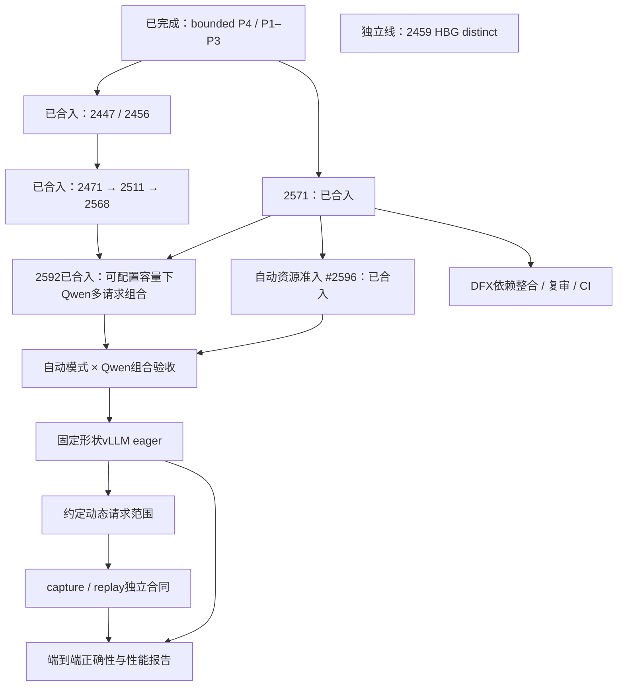

# Pipeline A：当前路线、阶段状态与交接

核对时间：2026-10-17T10:44:15.807101+00:00。主线基线：`2ee57567d01d0d86d5afb605f15e644a06a16200`。总集成跟踪：[Issue #2429](https://github.com/hw-native-sys/simpler/issues/2429)；原始异步目标：[#1853](https://github.com/hw-native-sys/simpler/issues/1853)。

本页是当前阶段表；[HTML 看板](run-pipeline-track-a.html)使用同一批事实。旧 `748c39fbe` 设计与旧进度保留在[历史快照](../../LOCAL-EVIDENCE.md#artifact-e9af7bab9363)，不能作为当前待办。

设计方向更新：默认自动资源准入；PR/CI证据仍以以上核对时间为准。

#2588当前4ec3ef36a，未Ready；CI12成功、1跳过、4失败、2取消。软件源修复#2609已合入；#2588旧CI基线不含该修复，下一次CI需先集成主线。DFX #2588已取得新的有效PMU失效对照：修订探针的四轮数值和任务身份全部通过，第一轮513条计数全零，后三轮各513条正值。坏轮与正常轮的两次AICore SPR采样相同且bit0开启，AICPU首次MMIO控制值却分别为2和7；两者不能直接当作同一寄存器，也不能据此归因驱动或卡损坏。原作者继续核同一任务的接收确认、执行和首次读回时序，准备下一项有判别力的定位；不重复已跑场景。早先探针的UB依赖及解析列问题已修正，失败现场保留。三项CI安装失败需集成已合入#2609后验证；#2588仍未Ready，未声称PMU已修复。 8条反馈已关闭，A5 HBG ArgsDump延期。 #2596当前提交与历史CI分开记录，见下。

外部接口整合：[#2599](https://github.com/hw-native-sys/simpler/pull/2599)公开直接L2的borrowed context/caller-stream eager接口；[#2600](https://github.com/hw-native-sys/simpler/pull/2600)修复PMU关闭及部分初始化失败时的资源清理。前者不等于本地L3自动准入，后者尚未证明能解决本线PMU全零；各由原作者负责。前者#2599已合入main，后者#2600仍开放；实际差异已核，后续整合需保留各自接口与测试。

CI辅助#2609已合入main 0d05dfd54，合入补丁与已审3ace7ba74精确一致。合入前CI18成功、1跳过；修复源文件索引更新时未正确使用既有重试的问题。持续软件源故障仍可能失败，且不代表DFX的PMU问题已修复。

## 当前执行

native重入修复#2611已合入0eda81c93；合入补丁与已审ef4700483一致，合入前CI18成功、1跳过，本轮未重测。自动准入与真实Qwen组合的五文件补丁已完成主审和独立复审；本地扩展与当前源码匹配后，15个新增CPU用例首次运行全部通过，覆盖有限缓冲、输出验证后复用、观察身份及关闭边界。硬件组合尚未验收：A3 HBG三端及必要辅助二进制已完成当前源码构建，实际读取路径与指纹核准；现有fixture/KV及历史编译产物只读权限仍待回复，随后校验输入并编译Qwen callable；CPU结果不外推设备正确性或容量覆盖。

测试维护#2613已合入main 2ee57567d：删除SIMPLER_UT_TRB_RUNTIME，HBG/TMR专属测试独立组织，保留15个目标和248个既有实例，并补全HBG Runtime默认图描述符的三个初值。合入树与已审30ed1de42完全一致；合入前18项成功、1跳过，macOS 326和Ubuntu 327个CTest目标全部通过。本轮仅核对合入源码，未重跑测试；不代表Qwen自动组合或DFX已验收。

DFX #2588已取得新的有效PMU失效对照：修订探针的四轮数值和任务身份全部通过，第一轮513条计数全零，后三轮各513条正值。坏轮与正常轮的两次AICore SPR采样相同且bit0开启，AICPU首次MMIO控制值却分别为2和7；两者不能直接当作同一寄存器，也不能据此归因驱动或卡损坏。原作者继续核同一任务的接收确认、执行和首次读回时序，准备下一项有判别力的定位；不重复已跑场景。早先探针的UB依赖及解析列问题已修正，失败现场保留。三项CI安装失败需集成已合入#2609后验证；#2588仍未Ready，未声称PMU已修复。

## 当前结论

步骤一有界 P4/P1–P3 验收已完成；步骤二 #2447/#2456、步骤三 #2471/#2511/#2568/#2592 均已合入当前 main。普通异步并非仍是单 launched；剩余重点是动态资源扩展收口、真实 workload 组合，以及 DFX 完整接线。

#2571 已合入 `78365f79c`，合入补丁与已审 a002 一致；合入基线 `a2b0ad2` 已包含#2592且合入补丁核验一致；#2593将communicator控制状态移入chip子进程循环，不改变自动准入范围。合入前CI18成功1跳过，四后端容量、五run入队和64次持续提交已有证据，本轮未重测。按用户最新方向，普通submit默认按资源自动准入，不要求配置多个depth；原Qwen固定4/2示例方案及其审批撤回。普通异步#2596已合入main a2b0ad2；合入树与已审77460ea26完全一致。四后端默认自动准入、持续补队、HOST/DEVICE寿命、失败/关闭及双端点验收已有证据，合入前CI18成功、1跳过，五条反馈已关闭；本轮未重测。内部slot是可复用资源组编号，自动身份目录最多168项，不是固定2/3份准入。冷启动先准入一个逻辑run，首run完整退休并反馈容量后才扩展，会减少首对请求的重叠机会。Qwen自动模式组合尚未验收；合入后源码复核已完成：arena竞争被reservation门禁阻断，FIFO容量折入正确；native同线程跨context重入已由4项基线对照复现，修复14项验证通过并发布#2611，已合入0eda81c93，合入前CI18成功1跳过、补丁核验一致。 manager已更新[设计要求](../../LOCAL-EVIDENCE.md#artifact-fa3c46d23d4a)，已完成[完整实施合同](../../LOCAL-EVIDENCE.md#artifact-46af702a03da)，实现已合入，继续合入后复核和真实Qwen自动模式组合。

普通异步#2611已合入，Qwen15项新增CPU通过、硬件待输入；DFX旧版边界观察已完成，再次复现初始化后至首次读数前失效。合入事实、设计目标与执行证据分开记录。

**外部在途更新：** [#2605](https://github.com/hw-native-sys/simpler/pull/2605) 已开放，固定形状单 A3 HBG 的 vLLM eager 适配使用 borrowed L2/caller stream，提交前排干并等待本次完成。作者报告 CPU 验证；真实模型板端及性能未验收。本地 L3 自动资源准入不在该 PR 范围，由原作者负责，不重复开发。

main另已合入#2604四后端零任务完成修复和#2606；后者只补L2 caller-stream事件与D2D依赖测试，不替代本地L3默认自动模式验收。

## 步骤一至三：已合入交付

| 阶段 | 状态 | 交付 | 证据与边界 |
| --- | --- | --- | --- |
| 步骤一 | 已完成（有界范围） | bounded P4 / P1–P3 验收 | 本地 L3 A3 HBG、同 endpoint、单任务 HOST 路径的提前入队、设备串行、FIFO、资源/结果寿命及持续补队已验收。历史 endpoint 故障未稳定复现，处置不等于厂商根因已修复。 |
| 步骤二 | 已合入 | [#2447](https://github.com/hw-native-sys/simpler/pull/2447) / [#2456](https://github.com/hw-native-sys/simpler/pull/2456) | 真实 Qwen depth-one Worker.submit；127 步 token/logits/KV 验证。请求 depth=2 时的 HOST sampled-token 依赖仍明确回退 depth=1；这是该旧路径结论，不代表后续 DEVICE 路径未实现。 |
| 步骤三 A | 已合入 | [#2471](https://github.com/hw-native-sys/simpler/pull/2471) | clone-request 合同：请求内容可以相同，身份、KV、metadata、输出、staging、event 与资源租约必须独立；不依赖 HBG distinct。 |
| 步骤三 B | 已合入 | [#2511](https://github.com/hw-native-sys/simpler/pull/2511) | 真实 Qwen 双请求：127 对 decode 请求、127 次 joined launches；token/logits/KV 门通过，设备 operator 仍串行。板端证据采于 PR 记载的早期 head，不能写成本轮重测。 |
| 步骤三 C | 已合入 | [#2568](https://github.com/hw-native-sys/simpler/pull/2568) | 同请求连续 DEVICE feedback：127 步 decode，126 条相邻边 joined，其中 125 条 refill；限定单 A3 HBG endpoint、diagnostics disabled、固定步数。不是 A5/TMR/通信/任意动态请求的支持声明。 |
| 步骤三 D | 已合入 | [#2592](https://github.com/hw-native-sys/simpler/pull/2592) | 六请求636步、619条joined边、608条refill；现有可配置容量，单A3 HBG、固定形状、关闭诊断。替换请求有排干检查点；自动准入另验。 |

## P0–P6 当前阶段表

P0–P6 是设计职责，不与某一个 PR 一一对应；下表分别标注有界已交付、当前扩展和剩余验收。

| 阶段 | 核定状态 | 实现证据 | 当前边界与剩余工作 |
| --- | --- | --- | --- |
| P0 · 测量基线 | 已有基线，最终性能验收未完成 | [#2262](https://github.com/hw-native-sys/simpler/pull/2262) | 已有设备时基与观测工具；同负载、同设备条件下的端到端正确性、吞吐、长尾和资源峰值报告仍待交付。 |
| P1 · run 私有资源 | 有界普通路径已交付 | [#2268](https://github.com/hw-native-sys/simpler/pull/2268) / [#2275](https://github.com/hw-native-sys/simpler/pull/2275) / [#2283](https://github.com/hw-native-sys/simpler/pull/2283) / [#2298](https://github.com/hw-native-sys/simpler/pull/2298) | 计时、arena、结果与终态按 run 保留。动态资源表由 #2571 扩展；不能用历史固定容量验收替代组合验收。 |
| P1 · DFX 资源与身份 | 基础已合入，完整接线未完成 | [#2534](https://github.com/hw-native-sys/simpler/pull/2534) / [#2563](https://github.com/hw-native-sys/simpler/pull/2563) | #2588当前4ec3ef36a/base17129，单提交、未Ready；CI12成功、1跳过、4失败、2取消。软件源重试修复#2609已合入，2588原失败job未重跑。DFX #2588已取得新的有效PMU失效对照：修订探针的四轮数值和任务身份全部通过，第一轮513条计数全零，后三轮各513条正值。坏轮与正常轮的两次AICore SPR采样相同且bit0开启，AICPU首次MMIO控制值却分别为2和7；两者不能直接当作同一寄存器，也不能据此归因驱动或卡损坏。原作者继续核同一任务的接收确认、执行和首次读回时序，准备下一项有判别力的定位；不重复已跑场景。早先探针的UB依赖及解析列问题已修正，失败现场保留。三项CI安装失败需集成已合入#2609后验证；#2588仍未Ready，未声称PMU已修复。 8条反馈已关闭，A5 HBG ArgsDump延期；不外推未验收collector。 |
| P2 E1 · 健康消费者 | 已合入，不再是“下一项” | [#2303](https://github.com/hw-native-sys/simpler/pull/2303) / [#2354](https://github.com/hw-native-sys/simpler/pull/2354) / [#2374](https://github.com/hw-native-sys/simpler/pull/2374) | callback owner、故障证据及匹配设备代际的停止准入已交付；通知不自动归属某个 run，通知缺席不证明成功。 |
| P2 E2 · 完成与安全退休 | 批准的有界 program 范围已完成 | [#2272](https://github.com/hw-native-sys/simpler/pull/2272) / [#2298](https://github.com/hw-native-sys/simpler/pull/2298) / [#2330](https://github.com/hw-native-sys/simpler/pull/2330) / [#2379](https://github.com/hw-native-sys/simpler/pull/2379) / [#2391](https://github.com/hw-native-sys/simpler/pull/2391) / [#2411](https://github.com/hw-native-sys/simpler/pull/2411) | 有效本 run 完成证据与 Ok 判定走正常分支；错误、Partial 或停止未知保留对应回退/隔离。不得外推所有故障形态都无同步。 |
| P3 · FIFO / build / host 访问 | 已合入；步骤一有界集成验收完成 | [#2314](https://github.com/hw-native-sys/simpler/pull/2314) / [#2356](https://github.com/hw-native-sys/simpler/pull/2356) / [#2399](https://github.com/hw-native-sys/simpler/pull/2399) / [#2406](https://github.com/hw-native-sys/simpler/pull/2406) | 保持 parent FIFO、recorder/build 所有权及调用方 host 就绪合同。扩大准入后仍需对应组合回归，不自动推导跨 run host 数据依赖。 |
| P4 · native 提前入队 | 四后端有界能力已合入 | [#2419](https://github.com/hw-native-sys/simpler/pull/2419) / [#2481](https://github.com/hw-native-sys/simpler/pull/2481) / [#2491](https://github.com/hw-native-sys/simpler/pull/2491) / [#2560](https://github.com/hw-native-sys/simpler/pull/2560) | A3/A5 × HBG/TMR 设备串行、后继可提前提交；HBG 三套资源有 #2466/#2531。各 PR 的 endpoint、输入及诊断限制分别有效。 |
| P5 · 真实 Worker.submit 与持续补队 | 有界公开路径已交付 | [#2419](https://github.com/hw-native-sys/simpler/pull/2419) / [#2446](https://github.com/hw-native-sys/simpler/pull/2446) / [#2471](https://github.com/hw-native-sys/simpler/pull/2471) / [#2511](https://github.com/hw-native-sys/simpler/pull/2511) / [#2568](https://github.com/hw-native-sys/simpler/pull/2568) | 真实 API、clone 双请求与同请求 DEVICE 连续反馈均有证据；现有可配置容量下的组合验收#2592已合入；默认自动资源准入#2596已合入，其Qwen组合验收仍待完成。 |
| P6 · 资源准入、背压与吞吐 | 容量扩展已合入；组合/性能待验收 | [#2571](https://github.com/hw-native-sys/simpler/pull/2571) | 四后端容量 grant、launch_depth=4、64 次连续提交及五 run 场景已有证据；78365f79c已合入，补丁与已审a002一致；main源码基线已核，自动资源准入完整合同已批准，#2596当前77460ea26已完成自动资源压力、持续运行与失败/关闭验收，CI18成功1跳过及五条反馈闭环，已合入；Qwen自动模式组合与性能仍待验收；旧示例审批已撤回。 |

## 剩余工作与依赖

| 工作层 | 依赖 / 顺序 | 交付与限制 |
| --- | --- | --- |
| R1 · 容量扩展收口 | #2571 已合入 → main 源码基线已核 | 合入补丁核验完成；历史CI不冒充最新main重测，后续集中组合验收。 |
| R2 · 动态资源 × 真实 Qwen | R1 + 已合入 #2471/#2511/#2568 | 组合验证自动准入、transport/执行背压、持续 refill、DEVICE 最后消费者、失败/关闭；组件分别通过不等于组合已通过；旧4/2与固定N+1示例方案撤回；#2596的77460ea26已完成静审、CI及反馈闭环，已合入；随后完成Qwen自动模式组合验收。#2592已合入1a8a3ee2，合入补丁与已审93b7b4c3一致；最终CI18成功、1跳过，macOS重跑成功。作者板端证据为六请求636步、619条joined相邻边、608条refill，数值与最后消费者检查通过，小窗口和失败关闭对照完成。范围限固定形状、单A3 HBG端点、关闭诊断，替换请求设显式排干检查点；不代表自动资源准入或任意动态请求已验收。本轮未重测。 自动准入已合入；native重入修复#2611已合入0eda81c93，补丁核验一致，不重复#2592 driver。 |
| R3 · DFX 完整跨 run 接线 | P4依赖整合 → 语义复审 → 精确head CI / collector验收 | #2588当前4ec3ef36a，未Ready；CI12成功、1跳过、4失败、2取消。软件源修复#2609已合入；#2588旧CI基线不含该修复，下一次CI需先集成主线。DFX #2588已取得新的有效PMU失效对照：修订探针的四轮数值和任务身份全部通过，第一轮513条计数全零，后三轮各513条正值。坏轮与正常轮的两次AICore SPR采样相同且bit0开启，AICPU首次MMIO控制值却分别为2和7；两者不能直接当作同一寄存器，也不能据此归因驱动或卡损坏。原作者继续核同一任务的接收确认、执行和首次读回时序，准备下一项有判别力的定位；不重复已跑场景。早先探针的UB依赖及解析列问题已修正，失败现场保留。三项CI安装失败需集成已合入#2609后验证；#2588仍未Ready，未声称PMU已修复。 8条反馈已关闭，A5 HBG ArgsDump延期。 |
| R4 · 固定形状 vLLM eager | 普通异步组合边界成立；目标 workload / ABI / 输出合同固定 | 外部#2605已开放：固定形状单A3 HBG、borrowed L2/caller stream；作者报告CPU及四种caller-stream硬件变体通过，真实模型与性能尚未验收，不覆盖本地L3自动准入。 |
| R5 · 约定动态请求范围 | 固定形状 eager + 明确 batch / request lifecycle 范围 | 逐项约定准入、取消、失败、回收和资源背压；不宣称无限请求或无限内存。 |
| R6 · capture / replay | 准备产物、参数绑定、graph 引用寿命及目标 SDK 合同成立 | 后续独立能力；当前普通异步不以 capture 实现为前置。 |
| R7 · 端到端报告 | 目标场景正确性门完成；性能需相同 workload / 设备 / 软件条件 | 分别给 eager 与 capture（若交付）的结果、吞吐/延迟、长尾、资源峰值和残余空档；没有未测收益承诺。 |
| 独立能力线 · HBG distinct #2459 | 按其自身数值正确性证据推进 | 不作为 clone-request 或已验证 DEVICE feedback 的前置；只有未来选择 distinct workload 时才成为该场景依赖。 |

**依赖澄清：** #2592使用已交付的可配置容量，不依赖后续#2596默认自动准入。源码基线已核与“未额外重跑测试”是证据备注，不是未完成的验收关卡。#2596完成后与#2592路径组合，才验收自动模式。

DFX 与 workload 组合可以在职责和写入范围清楚时并行；依赖整合必须使用最终审定的 P4 基线。HBG distinct 不连接到 clone/DEVICE feedback 的前置链。

### 已合入的Qwen组合验收

#2592已合入1a8a3ee2，合入补丁与已审93b7b4c3一致；最终CI18成功、1跳过，macOS重跑成功。作者板端证据为六请求636步、619条joined相邻边、608条refill，数值与最后消费者检查通过，小窗口和失败关闭对照完成。范围限固定形状、单A3 HBG端点、关闭诊断，替换请求设显式排干检查点；不代表自动资源准入或任意动态请求已验收。本轮未重测。 [查看 PR #2592](https://github.com/hw-native-sys/simpler/pull/2592)。

#2589已合入：直接L2使用原生chip绑定；#2566已合入：HBG主机构图临时存储复用；#2575已合入：CI工具变更分类。这些不等于自动资源准入已交付。

## 支线状态

- **DFX：** 已合入身份、后台输出和有界泳道能力；完整多 collector 跨 run 接线在原 temporal 分支，尚待最终依赖整合、复审、CI。详见[整合审查](../../LOCAL-EVIDENCE.md#artifact-16574d2263c2)。
- **prepare / 上传：** 注册资源复用、TMR 调用参数进入 launch（#2432）、执行配置复用（#2438）、HBG 图定义进入 RTS launch 参数（#2487）已交付；不等于所有传输成本已消失或性能最优。
- **内存：** 四类 workspace 默认生命周期管理（#2473）及图定义设备块移交 RTS（#2487）已合入。请求私有存储和最后消费者规则仍须随 #2571 扩展核验；[内存报告](../../LOCAL-EVIDENCE.md#artifact-ee79834e8745)的存储分类与源码基线单独标注。

## 规范边界

- 设备 operator 串行；提前入队允许 host 准备/提交与前驱执行重叠，不等于设备算子并发。
- parent FIFO 保持；accepted、prepared、enqueued、completed、retired 是不同边界。
- 请求私有资源按最后消费者退休；用户 tensor 所有权不被内部保留机制接管。
- 请求/资源套数 grant 与字节预算是两个维度：grant 限制可持有的资源数量，不保证任意 tensor 尺寸都能分配成功。workspace 预算可选；资源有限、背压和分配失败必须明确。DFX 预算独立。
- 不添加隐式跨 run host 同步，不自动推导任意 host 数据依赖；DEVICE feedback 仅按已验证的生产者/消费者和寿命合同使用。
- 平台、runtime、endpoint 数、任务形态、输入类型和 diagnostics 模式分别声明；未验证组合不得外推。
- 一个 PR 交付一个完整功能，含持续运行、背压、错误/关闭和真实 API 验收；不继续按 2→3→4 拆零碎容量 PR。

### 内部资源管理与可选预算

旧“Init 必须确定总上限”不再是通用前提。L2/L3 按所属合同管理分配、复用、扩容失败保全与最后消费者；可选预算不能替代寿命证明，也不等于覆盖用户 tensor、RTS、代码缓存和全部设备内存。具体资源各自核算。

### 资源套数、传输帧与执行深度

#2571 把 request transport 与执行资源寿命分开。传输帧收到消费确认后可复用，run 身份/终态和执行资源各按自己的最后消费者保留；资源 grant 与 launch_depth 分开约束，不能从“配置任意正整数”推断资源无限。该 PR 已合入78365f79c。

## 证据入口与历史

- [E2 有界收口](../../LOCAL-EVIDENCE.md#artifact-03fee72fb1e2)、[P3 交接](../../LOCAL-EVIDENCE.md#artifact-eeac338ebd70)。
- [#2571 历史 Ready 验收](../../LOCAL-EVIDENCE.md#artifact-d1caeb49985a)、[当前提交与 CI 复审](../../LOCAL-EVIDENCE.md#artifact-01940bbb0835)。
- [#2568 精确 head 评审](../../LOCAL-EVIDENCE.md#artifact-1e8d23ac687c)；127 步数据是 PR 作者的板端证据，不是本次 manager 重测。
- [运行时原则](runtime-design-principles.md)、[工作管理约定](../../LOCAL-EVIDENCE.md#artifact-579c8abdfab8)、[当前授权登记](../../LOCAL-EVIDENCE.md#artifact-ada206aaafff)。
- [早期总体设计](../../LOCAL-EVIDENCE.md#artifact-ac0b78177977)是历史设计基线；旧 P1/P2 分工、DFX 矩阵和旧评审不再承担实时状态。

### 自动准入的下一步

默认自动准入已随#2596合入：内部按复用、可控增长、可等待回收和不可满足分流，旧显式配置兼容。下一步复用#2592验证真实Qwen自动模式，分别报告正确性、实际容量和未覆盖的总内存峰值；见[现行方案](../../LOCAL-EVIDENCE.md#artifact-fa3c46d23d4a)。

DFX当前失败已按八类机制核对，最终提交需逐项闭合：[失败与候选修复清单](../../LOCAL-EVIDENCE.md#artifact-d47b11f96638)。其中预算固定开销与未释放记录分开判断；候选修改不等于测试通过。
