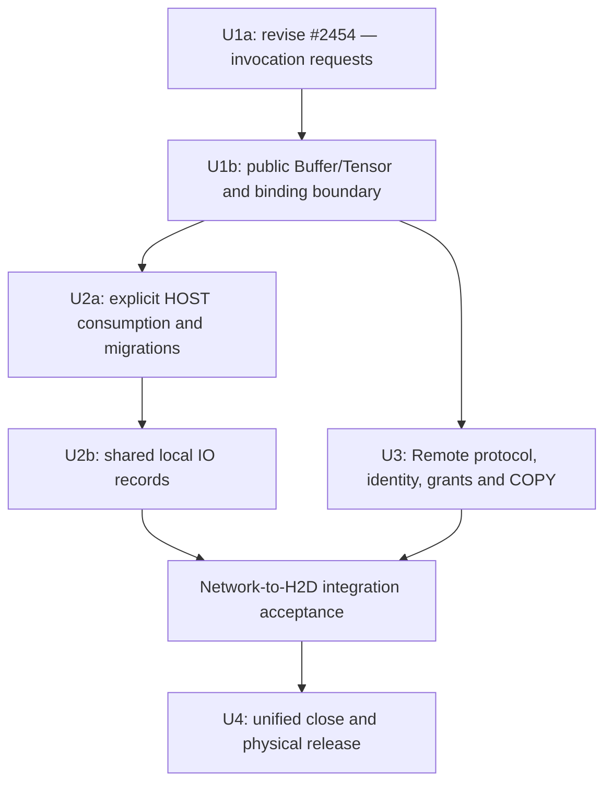

# Issue #2460 — published design snapshot

https://github.com/hw-native-sys/simpler/issues/2460

Published from the selected local Tensor/Buffer design. This file records the initial issue body; subsequent implementation status belongs to the GitHub issue.

### Summary

Unify the public argument model across L3+, Remote and L2/ChipWorker around **one `Buffer` type and one `Tensor` type**:

- **Buffer describes storage**: canonical identity, capacity, physical HOST/DEVICE location, owner endpoint, backend and existing grants.
- **Tensor describes a view**: Buffer reference, dtype, shape, strides and byte offset.
- **A TaskArgs entry describes this invocation's use**: the Tensor value, existing direction/tag and an independent transfer request.
- **The runtime resolves and retains the binding internally**: endpoint-local address/span, source/destination relationship, copy actions and completion obligations.

This is the implementation parent for a selected design, with bounded delivery steps and acceptance gates below. It includes the disposition of #2454. It does not claim that the proposed API or all access/lifetime semantics are already implemented.

### Motivation / Use Case

The current public surface exposes both descriptor-based `Tensor` and address-bearing `ChipTensor`, while local buffers, imported buffers and remote references follow partially different resolution and lifetime paths. Adding a transfer field separately to these surfaces would preserve two public models and attach invocation policy to a reusable view.

The desired usage is simpler: the same public Tensor/Buffer concepts work for local or remote storage, on host or device. Users select a view and explicitly request how a particular invocation uses it. Internal representation changes do not require users to construct another kind of Tensor.

Concrete cases this must cover:

1. A HOST tensor used only by HBG host orchestration, with no implicit device upload.
2. A HOST tensor passed through Program-managed device IO, preserving IN/OUT/INOUT behavior.
3. An existing DEVICE tensor borrowed by Program or kernel execution.
4. Separate host-control and device-operand arguments when both sides need data, including MTP control and persistent KV/cache state.
5. Remote owner/import references and explicit network copies, optionally followed by a separately requested local H2D binding.
6. Multiple views of one allocation, with correct alias identity and release after actual last use.

The existing `Worker._materialize_l2_args` path already accepts `TaskArgs<Tensor>` at L2 and resolves it before `run_materialized`. This is the starting point; a second materializer or runner is unnecessary.

### Proposed API / Behavior

#### 1. Object responsibilities

| Object | Owns/describes | Must not acquire implicitly |
| --- | --- | --- |
| Buffer | Storage identity, location, capacity, owner route, backend and owner/import grant | Tensor geometry or a per-call transfer policy |
| Tensor | Buffer reference, dtype/shape/stride/offset, optional mapping-grant reference | Allocation ownership merely because the view wrapper exists; mutable per-call transfer policy |
| TaskArgs tensor entry | Tensor value, existing direction/tag, `TensorTransfer` request | A second host/device argument list or a new per-Tensor permission field |
| Endpoint attachment | A validated mechanism to access backing at a particular endpoint/context generation, with range and grant | A directly dereferenceable address merely because a copy channel exists |
| Per-invocation binding | Resolved address/span and access domain, retained references, source/destination and IO records | A reusable PreparedCall or an automatic cross-call cache |

`BufferDescriptor` remains the serialization of Buffer, not a second public storage abstraction. `ChipTensor` may remain an internal ABI encoding during migration; existing low-level callers receive a compatibility adapter. HBG/TMR's execution and dependency-tracking Tensor structures need not be rewritten to make the public model uniform.

**Placement and reachability are different facts.** HOST/DEVICE is physical placement. Local/remote is a relationship between the owning and consuming endpoints. A remote DEVICE allocation has both properties; it does not need an `AddressSpace::REMOTE_DEVICE` value.

**Addresses remain backend-specific.** A Buffer description can contain a device VA, a shared-memory locator or a remote owner reference. The consuming endpoint validates and resolves it before deriving the Tensor's address from the covered range and byte offset. A foreign process's address is not a usable local pointer; copy-only remote access produces a copy operation, not a fake local address.

#### 2. Target invocation API

This is the target API, not a claim that these keywords already work:

```python
h = worker.create_buffer(nbytes)
x = h.tensor(shape, dtype)

args.add_tensor(x, TensorArgType.INPUT, transfer=TensorTransfer.NONE)
args.add_tensor(x, TensorArgType.INPUT, transfer=TensorTransfer.H2D)

# Existing DEVICE backing; its ownership is unchanged.
y = device_buffer.tensor(shape, dtype)
args.add_tensor(y, TensorArgType.INOUT, transfer=TensorTransfer.NONE)
```

The same `x` remains unchanged. The two argument entries explicitly request a host binding and a Program-managed device binding. Once bound, they are distinct execution parameters; the device parameter is not an implicit route back to the host source.

External L2 pointers first enter through a borrowed Buffer wrapper carrying capacity, location, endpoint and the caller's lifetime contract, then use this same Tensor/TaskArgs path. Wrapping does not transfer allocation ownership. Views of one registered allocation share its identity; repeated wrapping of overlapping raw pointers cannot silently claim independently verified alias identities.

Compatibility is resolved once at the old entry boundary: omitted transfer retains existing Program HOST/H2D and DEVICE/NONE behavior; explicit NONE remains distinguishable from omission. `child_memory` is a compatibility input, not another persistent location field. After normalization, forwarding and receiving endpoints preserve the request instead of choosing defaults again. New examples state the request explicitly.

Scalar remains a typed value with its width and bit pattern preserved. An integer or float does not require a separate submission category, but the runtime must not convert all scalar payloads to integer values. A changing device-resident scalar remains a Tensor.

#### 3. Supported combinations and explicit rejection

| Source / request | Program target behavior | Kernel target behavior |
| --- | --- | --- |
| HOST / NONE | Host-only HBG input/output according to the declared contract; not consumable by TMR/device tasks | Explicit host preparation; retained control bytes are snapshotted at the host preparation boundary |
| HOST / H2D | Create a separate DEVICE binding managed by Program IO | Reject: kernel mode does not implicitly transport user tensors |
| DEVICE / NONE | Borrow the existing DEVICE storage | Borrow the existing DEVICE storage |
| DEVICE / H2D | Reject | Reject |
| D2H parameter request, unknown enum or invalid combination | Reject | Reject |
| HOST-to-DEVICE or DEVICE-to-HOST mapping view | Unsupported; explicit error | Unsupported; explicit error |

Here H2D names the existing **Program device-binding policy**, not a count of copy instructions: INPUT copies in, OUTPUT does not read uninitialized host data and copies back after execution, INOUT does both. A missing direction retains the current conservative handling where that contract permits it. Existing explicit `copy_from`/`remote_copy_from` APIs remain available; rejecting a D2H *parameter tag* does not remove those operations.

Host orchestration must not implicitly read DEVICE operands, and device execution must not directly consume HOST operands. Consumers needing both receive two explicit arguments. Removing current HBG cross-side get/set fallbacks and migrating all dependent examples/tests is one delivery unit, not an earlier silent behavior change.

Bounds use reachable span, offset, strides and element size, with overflow checks. Until a correct strided copy/scatter contract ships, reject noncontiguous managed H2D/copyback and overlapping writable H2D arguments. Native supported strided views remain valid. Empty views do not cause a data dereference, but still require valid dtype, identity and request checks.

All-call structural, combination and permission preflight precedes payload reads, allocation/copy side effects and launch. Unsupported requests log the reason and return/raise an error through the existing error path; `LOG_ERROR` followed by success is not rejection.

#### 4. Access, mapping and lifetime

Use the existing Buffer/import/mapping grants and derive required reads/writes from TaskArgs tags, callable signatures and actual operations. Do not add `Tensor.access`, `view_access` or `ChipTensor.effective_access`.

Binding checks identity/generation, exact endpoint/chip, grant, reachable range, product policy and implemented backend capability. Checking validity and acquiring an accepted use must be atomic with close/free/unmap. A valid address and sufficient rights do not prove producer completion.

- External producer data remains the caller's readiness obligation; declared L3 producer dependencies are honored before reading or snapshotting HOST content.
- HBG completes host decisions before launch. An invocation cannot partially execute, return to host for a decision, then secretly launch its remainder; split the invocation explicitly or make the decision on device.
- MTP KV cache, weights and persistent state are explicit DEVICE inputs/INOUT, not per-invocation reset workspace.
- Replay consumes captured device effects; changing host control bytes does not imply rerunning host orchestration. Topology changes require rebuilding the graph.

The mapping design is fixed even though cross-side mapping is unsupported: an eventual `map_view` returns a **new Tensor** referencing the same backing and a separate target attachment/grant. It does not mutate the original Tensor or change Buffer's physical location. Ordinary same-side SHM import remains supported. Mapping shares backing identity; COPY writes a destination backing, with a new identity only when that destination is newly allocated.

The lifetime target is logical close followed by physical release after all required uses end. Existing valid owner/import/map handles and accepted device work, copies, host accesses, event waits and graphs carry their defined retention obligations. A3 completion covers both AICPU and AICore and any later IO. An ordinary Tensor descriptor or a Python wrapper is not an unlimited allocation-retention token and does not extend a HeapRing scope.

Each newly introduced path must retain resources safely immediately. Keep existing in-flight free rejection until deferred physical release is supported. Uncertain execution or failed remote cleanup does not prove quiescence; retain the relevant resources/journal until a confirmed release or controlled teardown. `Buffer.close` must ultimately route through the owner registry rather than bypassing it to unlink/free directly.

#### 5. Implementation steps and dependencies



Each row is a bounded PR unit. If a row needs further splitting, split by a real production consumer while preserving the same public contract. No step is an optional extension.

| Unit | Implementation boundary | Acceptance gate |
| --- | --- | --- |
| **U1a — revise #2454** | Put transfer on `TaskArgs.add_tensor` entries; carry it through local encoding, Worker/chip-child materialization and re-export; retain four-binder whole-call preflight | The same Tensor used as NONE/H2D/NONE leaves itself and earlier entries unchanged; request survives copying/forwarding; explicit NONE is not defaulted away; invalid final argument prevents reading an earlier unreadable address; existing Program IO stays valid |
| **U1b — one public model** | Consolidate Buffer/Tensor construction, borrowed-pointer wrappers and ChipWorker entry on existing `Worker._materialize_l2_args`/ImportRegistry paths; retain backing/grant/endpoint associations in each accepted binding | L3 child and L2 direct accept the same public TaskArgs model; wrong chip, stale generation, out-of-bounds and READ grant with OUTPUT fail; borrowed allocations are never freed as owned; old public ChipTensor callers are migrated before removal |
| **U2a — explicit HOST semantics** | Connect HOST/NONE to HBG host orchestration; HOST/H2D only exposes its DEVICE binding to device consumption; reject cross-side get/set; migrate PA/FIFO and all other affected dual-side users; enforce copy geometry/alias restrictions | Host-only input performs no upload; device-only input is not read on host; two-side cases pass explicit arguments; unsupported mapping fails; full affected HBG/TMR use cases pass |
| **U2b — common local IO records** | Connect HBG tensor loop and TMR `copy_in_device_args`/`tensor_leases` to common source/destination, copy, completion and cleanup records using existing prepare/finalize | Real IN/OUT/INOUT, allocation/copy failure, copyback, A3 last-use and borrowed-memory retention tests pass on both architectures |
| **U3 — Remote integration** | Pair producer/receiver/version changes; preserve entry requests, direction, grants, owner incarnation and owner-relative ranges; integrate remote COPY at the same binding/retention boundary | Unsupported peers fail explicitly; no receiver default H2D or grant widening; no host-backed transport allocation mislabeled as DEVICE; nonzero exported offsets and alias footprints agree; network→H2D delayed/failing paths retain intermediate storage and do not release successors early |
| **U4 — close semantics** | Consolidate owner/import/attachment use records, cleanup journal and public close routing; retain allocator-specific physical release | Close rejects new uses while accepted uses/independent grants survive; submit/close races, uncertain failures and generation reuse are safe; scope allocations do not gain accidental persistence; graph retention is tested with the real capture consumer |

After U1b, **U2a/U2b and U3 can proceed in parallel**. Combined network→H2D acceptance waits for both. Kernel eager consumes the local abilities it needs without waiting for every Remote backend; graph-specific retention integrates with the capture ownership milestone. Pipeline A supplies execution/completion/retirement mechanisms; this work must not create another admission scheme or runner.

#### 6. Current PR #2454

As checked for this issue, #2454 is OPEN at `7b3409991a7761a7f3ed5f52ab034f588519d047`, rebased on main `8cf4ed4c001fbee52a2cf5b0eb5e2722674277dd`. The rebase preserves its existing patch; it does **not** implement the interface revision in this issue.

**Keep the same PR and revise it before merge.**

- Keep independent `AddressSpace`/`TensorTransfer`, legacy compatibility, whole-call binder preflight, explicit Remote-v4 refusal and the associated regression tests.
- Move the new public transfer constructor options off `Buffer.tensor`, `Tensor` and `ChipTensor.make`, onto TaskArgs entries. A private binding-time ABI carrier may remain temporarily; that must not become a second public Tensor contract.
- Audit fixed device POD, local same-build mailbox and independently versioned Remote encoding separately. Moving the public keyword is insufficient.
- Keep HOST/NONE chip consumption deferred to U2a and new Remote requests unsupported until their paired implementation. Preserve current HBG behavior until its migration unit lands.
- Keep U1b ownership/wrapping, full HOST use-case migration, common IO and Remote upgrade out of this PR.

The rebased head passed 262 non-hardware C++ targets, 2740 Python tests (54 skipped), and all pre-commit checks locally. These results validate its present implementation, not the proposed revision or the entire parent design. New changes require their own checks.

#### 7. Parent completion checklist

- [ ] U1a: per-invocation request contract and #2454 disposition completed.
- [ ] U1b: one public Buffer/Tensor path, with internal resolution and safe accepted-use retention.
- [ ] U2a: explicit HOST consumption and all affected existing use cases migrated together.
- [ ] U2b: HBG/TMR local IO uses the shared lifetime/completion contract.
- [ ] U3: paired Remote migration, identity/grant/range preservation and real transport acceptance.
- [ ] Combined network→H2D delayed/failure paths validated.
- [ ] U4: common logical-close contract and correct allocator-specific physical release.
- [ ] Mapping requests explicitly rejected until implemented; mapping identity/lifetime contract remains intact.
- [ ] Public examples, reference docs, wire producers and consumers agree; no implicit alternate public Tensor model remains.

### Alternatives Considered

- Separate HostTensor/DeviceTensor or public Tensor/ChipTensor/RemoteTensor models: duplicates the user-visible storage and view contract. Internal ABI/transport representations can differ without becoming separate public models.
- Put transfer in Buffer: two uses of the same storage cannot request different invocation policies without changing storage identity/state.
- Put transfer in Tensor construction: couples a reusable geometry view to one invocation's use. TaskArgs entries provide the correct scope.
- Add HostControl/DeviceOperand lists or per-Tensor access fields: duplicates existing ordering, grants and direction information.
- Treat remote and device as the same enum value: loses their orthogonality and cannot describe a remote device or a network→H2D path correctly.
- Rewrite all internal PODs, allocators and Remote transports in one PR: unnecessary for a common public contract and too large to validate. Each step above uses a real consumer and keeps existing safety checks until its replacement is ready.

### Additional Context

Related: #1931, #2450. Related implementation: #2454.

- #1931 concerns identity and validation in the chip-child allocation/free control protocol. Coordinate it with the owner/binding/close work; a common public descriptor alone does not establish a trusted child-side allocation record.
- #2450 asks for intentional writable aliases in shared KV arenas across nested tasks. This parent preserves common backing identity and existing overlap checks, but does not itself authorize those aliases. Its explicit alias/access-footprint extension remains separately tracked; do not bypass overlap validation or fabricate Buffer identities to make the unified model appear to solve it.

#2444 is closed; its branch is migration reference only, not the target mixed address-space enum.

The main baseline already includes #2446's caller-device-buffer borrows and producer-dependent host-read handling. Preserve those mechanisms; U1b builds on them rather than claiming allocation retention is entirely new. The deliberate cross-side host-access restriction belongs to U2a with user migration. #2448 and #2455's DFX changes are part of the rebase baseline, not work delivered by this parent.

Source entry points (pinned baseline; locate by symbol rather than relying on moving line numbers):

- [Worker materialization and execution entry](https://github.com/hw-native-sys/simpler/blob/8cf4ed4c001fbee52a2cf5b0eb5e2722674277dd/python/simpler/worker.py): `_materialize_l2_args`, `_run_l2_materialized`.
- [Public Buffer and Tensor descriptors](https://github.com/hw-native-sys/simpler/blob/8cf4ed4c001fbee52a2cf5b0eb5e2722674277dd/src/common/task_interface/buffer.h) and [TaskArgs storage](https://github.com/hw-native-sys/simpler/blob/8cf4ed4c001fbee52a2cf5b0eb5e2722674277dd/src/common/task_interface/task_args.h).
- [Caller device allocation retention](https://github.com/hw-native-sys/simpler/blob/8cf4ed4c001fbee52a2cf5b0eb5e2722674277dd/src/common/platform/include/host/caller_device_buffers.h).

This issue is self-contained. Local planning HTML and experiment materials remain outside code PRs; implementation PRs contain code, necessary tests and shipped API reference updates.
